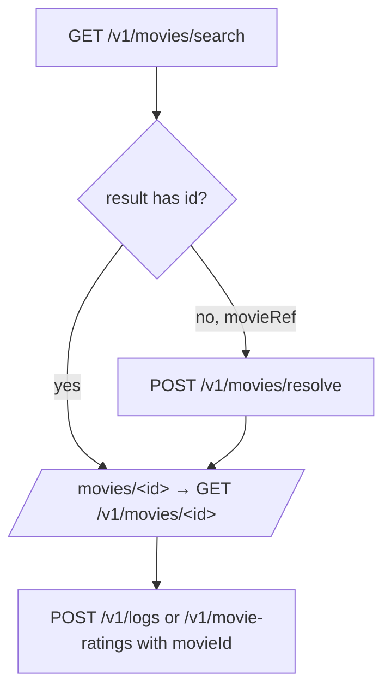

# Movie Search, Resolution and Details

**Last Updated:** 2026-10-31

## Table of Contents

- [Overview](#overview)
- [Authentication](#authentication)
- [Movie Identity](#movie-identity)
- [Endpoints](#endpoints)
  - [Search Movies](#search-movies)
  - [Resolve a Search Result](#resolve-a-search-result)
  - [Get Movie Details](#get-movie-details)
- [Client Flow](#client-flow)
- [Response Fields](#response-fields)
- [Edge Cases & Error Handling](#edge-cases--error-handling)
- [Removed Numeric Contract](#removed-numeric-contract)
- [See Also](#see-also)

---

## Overview

Cinelog lets authenticated users search for movies, open a movie's details, and log or rate it. Live data comes from [The Movie Database (TMDB)](https://www.themoviedb.org/), is localized for the viewer, and is cached in Redis.

Every movie in the Cinelog catalog has a **Cinelog movie UUID**. The API never exposes TMDB movie IDs.

## Authentication

All three endpoints require a valid session (`__Host-access_token` cookie). `POST /v1/movies/resolve` also requires the `X-CSRF-Token` header matching the `__Host-csrf_token` cookie. Clients should send the active locale in `Accept-Language`; the server falls back to the saved account locale. Unauthenticated requests receive `401`. See [Authentication](authentication.md) and [Account Localization](localization.md).

## Movie Identity

- A search result for a film **already in the catalog** has an `id` (its UUID).
- A search result for a film **not yet in the catalog** has a `movieRef` instead. It is an opaque string issued by the server. Clients pass it back unchanged and must not parse it or build one themselves.
- Exactly one of `id` and `movieRef` is set on each result; the other is `null`.
- Call `POST /v1/movies/resolve` with a `movieRef` to get the movie's UUID. Resolving imports the film into the catalog the first time anyone selects it.
- Details, ratings and logs are addressed by UUID only. Browser links use `/movies/<uuid>`.

---

## Endpoints

### Search Movies

```
GET /v1/movies/search?query={query}[&cursor={nextCursor}]
```

| Parameter | Type | Required | Description |
|-----------|------|----------|-------------|
| `query` | string | Yes | Search term (title or partial title) |
| `cursor` | string | No | `nextCursor` from the previous page of **the same query and locale** |

Rate limit: 20 requests per minute. Searching never adds movies to the catalog.

**Example response (200 OK):**

```json
{
  "results": [
    {
      "id": "6f1c2a9e-4b7d-4c1e-9a55-0d2b8f3e7a10",
      "movieRef": null,
      "title": "Inception",
      "overview": "Cobb, a skilled thief who commits corporate espionage...",
      "releaseDate": "2010-07-16",
      "posterPath": "/9gk7adHYeDvHkCSEqAvQNLV5Uge.jpg",
      "backdropPath": "/s3TBrRGB1iav7gFOCNx3H31MoES.jpg",
      "voteAverage": 8.4,
      "genreIds": [28, 878, 12],
      "originalLanguage": "en",
      "originalTitle": "Inception"
    },
    {
      "id": null,
      "movieRef": "eyJleHRlcm5hbElkIjoiNjQ5NTYiLCJwcm92aWRlciI6InRtZGIiLCJ2IjoxfQ.Zx9q…",
      "title": "Inception: The Cobol Job",
      "overview": "...",
      "releaseDate": "2010-12-07",
      "posterPath": null,
      "backdropPath": null,
      "voteAverage": 7.1,
      "genreIds": [16],
      "originalLanguage": "en",
      "originalTitle": "Inception: The Cobol Job"
    }
  ],
  "nextCursor": "eyJsb2NhbGUiOiJlbi1VUyIsInBhZ2UiOjIs…"
}
```

**Pagination.** Each response is one page from the provider. Pass `nextCursor` to fetch the next page; `null` means there are no more pages. A page can hold fewer than 20 results, and can even be empty while `nextCursor` is still set, because films removed from the Cinelog catalog and untitled films are left out. A cursor only works with the query and locale that produced it.

---

### Resolve a Search Result

```
POST /v1/movies/resolve
X-CSRF-Token: <csrf>
Content-Type: application/json

{ "movieRef": "eyJleHRlcm5hbElkIjoiNjQ5NTYiLCJwcm92aWRlciI6InRtZGIiLCJ2IjoxfQ.Zx9q…" }
```

Returns the UUID of the selected film. If the film is not in the catalog yet, it is imported first. Repeated or concurrent resolutions of the same film always return the same UUID, and resolving an existing film does not refresh its stored data. Rate limit: 20 requests per minute.

**Example response (200 OK)**, the same for both an existing and a newly imported film:

```json
{ "movieId": "0b6c1d2e-7f3a-4d5b-8c9e-1a2b3c4d5e6f" }
```

| Status | `error_code_name` | When |
|--------|-------------------|------|
| `200` | — | Resolved |
| `401` / `403` | — | Not authenticated / CSRF failure |
| `404` | `PROVIDER_MOVIE_NOT_FOUND` | The provider no longer has this film (first import only) |
| `409` | `MOVIE_UNAVAILABLE` | The film was removed from the Cinelog catalog |
| `422` | `INVALID_MOVIE_REF` | Malformed or tampered reference, or one issued by an older server version |
| `422` | validation error | Missing/empty `movieRef`, or extra fields such as `tmdbId` |
| `429` | — | Rate limit exceeded |
| `502` / `503` | `MOVIE_PROVIDER_INVALID_RESPONSE` / `MOVIE_PROVIDER_UNAVAILABLE` | Provider failure during first import |

A failed first import stores nothing. Retrying later is safe.

---

### Get Movie Details

```
GET /v1/movies/{movieId}
```

Returns live, localized details for a catalog movie.

**Example response (200 OK):**

```json
{
  "id": "6f1c2a9e-4b7d-4c1e-9a55-0d2b8f3e7a10",
  "title": "Inception",
  "originalTitle": "Inception",
  "overview": "Cobb, a skilled thief who commits corporate espionage...",
  "releaseDate": "2010-07-16",
  "posterPath": "/9gk7adHYeDvHkCSEqAvQNLV5Uge.jpg",
  "backdropPath": "/s3TBrRGB1iav7gFOCNx3H31MoES.jpg",
  "voteAverage": 8.4,
  "voteCount": 34521,
  "runtime": 148,
  "budget": 160000000,
  "revenue": 836848102,
  "status": "Released",
  "tagline": "Your mind is the scene of the crime.",
  "homepage": "https://www.warnerbros.com/movies/inception",
  "imdbId": "tt1375666",
  "originalLanguage": "en",
  "popularity": 96.3,
  "adult": false,
  "genres": [{ "id": 28, "name": "Action" }],
  "productionCompanies": [{ "id": 174, "name": "Warner Bros. Pictures", "logoPath": null, "originCountry": "US" }],
  "productionCountries": [{ "iso31661": "US", "name": "United States of America" }],
  "spokenLanguages": [{ "iso6391": "en", "name": "English", "englishName": "English" }]
}
```

| Status | When |
|--------|------|
| `200` | Active catalog movie |
| `404` `MOVIE_NOT_FOUND` | Well-formed UUID that is unknown or was removed from the catalog |
| `422` | Not a UUID, including old numeric TMDB IDs such as `/v1/movies/27205` |
| `404` / `502` / `503` | Provider errors (`PROVIDER_MOVIE_NOT_FOUND`, `MOVIE_PROVIDER_INVALID_RESPONSE`, `MOVIE_PROVIDER_UNAVAILABLE`) |

---

## Client Flow



Log autocomplete follows the same path: resolve the selected result first, then write with `movieId`.

---

## Response Fields

### Search Result Item

| Field | Type | Description |
|-------|------|-------------|
| `id` | UUID \| null | Cinelog movie UUID when the film is in the catalog |
| `movieRef` | string \| null | Opaque reference to resolve when `id` is `null` |
| `title` | string | Display title |
| `overview` | string | Short plot summary |
| `releaseDate` | string | `YYYY-MM-DD`, or `""` when unknown |
| `posterPath` | string \| null | Relative poster image path |
| `backdropPath` | string \| null | Relative backdrop image path |
| `voteAverage` | float | Provider user rating (0–10) |
| `genreIds` | integer[] | Genre IDs |
| `originalLanguage` | string | ISO 639-1 language code |
| `originalTitle` | string | Title in the original language |

### Full Movie Details

`id` is the Cinelog UUID. The other fields are unchanged: `voteCount`, `runtime`, `budget`, `revenue`, `status`, `tagline`, `homepage`, `imdbId`, `popularity`, `adult`, `genres`, `productionCompanies`, `productionCountries`, `spokenLanguages`, plus the search display fields.

---

## Edge Cases & Error Handling

| Scenario | Outcome |
|----------|---------|
| Missing `query` | `422` |
| `cursor` from another query/locale, tampered or malformed | `422 INVALID_PAGINATION_CURSOR` |
| Provider returns no results | `200` with `"results": []` and `"nextCursor": null` |
| Every result on a page is removed/untitled | `200` with `"results": []`; continue with `nextCursor` if set |
| Film removed from the catalog | Hidden from search; `/resolve` → `409`; details/ratings/writes by UUID → `404` |
| Provider timeout, 429 or 5xx | `503 MOVIE_PROVIDER_UNAVAILABLE` |
| Provider returns malformed data | `502 MOVIE_PROVIDER_INVALID_RESPONSE` |
| Redis unavailable at runtime | `500` |

Search caches each provider page for 10 minutes and details for 24 hours, separately by language. First imports use English (`en-US`) metadata.

## Removed Numeric Contract

Since #225 (released together with `cinelog_web` #97/#98):

- `GET /v1/movies/{tmdbId}` and `GET /v1/movie-ratings/{tmdbId}` are gone. Numeric IDs fail UUID validation (`422`) and are never looked up, redirected, or imported.
- `tmdbId` was removed from every response and is rejected in requests (`422`), even next to a valid `movieId`.
- Search no longer returns `page`, `totalResults` or `totalPages`.
- Old browser links such as `/movies/11304` show the not-found page.

## See Also

- [Movie Ratings API](movie-ratings-api.md)
- [Logs API](logs-api.md)
- [Account Localization](localization.md)
- [Technical: Canonical Movie Identity](../technical/movie-identity.md)
- [Technical: Movie Provider Mappings](../technical/movie-provider-mappings.md)
- [Technical: TMDB Movie Provider](../technical/tmdb-service.md)
