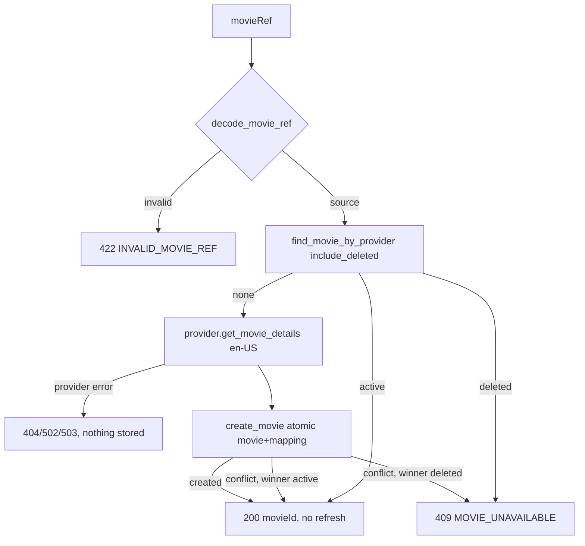

# Canonical Movie Identity (UUID-only API)

**Last Updated:** 2026-10-31

Issue #225 removed every public TMDB movie identifier. Cinelog movie UUIDs (`movies.id`) are the only public movie identity; provider IDs stay inside `movie_providers` and inside the backend-issued `movieRef`. No schema migration was needed: #255 and #248 had already moved provider identity to `movie_providers`.

## Table of Contents

- [Identity Model](#identity-model)
- [movieRef](#movieref)
- [Search Pagination Cursor](#search-pagination-cursor)
- [Search](#search)
- [Resolution](#resolution)
- [UUID Reads and Writes](#uuid-reads-and-writes)
- [Removed Legacy Contract](#removed-legacy-contract)
- [Caches](#caches)
- [Deployment and Rollback](#deployment-and-rollback)
- [Validation](#validation)
- [See Also](#see-also)

## Identity Model

| Object | Identity field | Meaning |
|---|---|---|
| Search result for a catalog film | `id` | Cinelog movie UUID |
| Search result not yet in the catalog | `movieRef` | Signed provider reference, resolved by `POST /v1/movies/resolve` |
| Movie details (`GET /v1/movies/{movieId}`) | `id` | Cinelog movie UUID |
| Log, rating, resolve response, write bodies | `movieId` | Cinelog movie UUID referencing a movie |

Naming rule: `id` when the object *is* the film, `movieId` when it *references* one. A search item carries exactly one of `id` and `movieRef`. The other one is `null`, enforced by a `MovieSearchResultItem` model validator.

## movieRef

`app/utils/movie_ref_utils.py` encodes a `MovieSourceReferenceDTO` as a stateless HMAC-signed token. Nothing is stored server-side, and the token does not expire.

```
payload   = {"externalId": "550", "provider": "tmdb", "v": 1}   # canonical JSON, sorted keys
movieRef  = base64url(payload) + "." + base64url(HMAC-SHA256(MOVIE_REF_HMAC_SECRET, base64url(payload)))
```

- Signing and verification live in `app/utils/signed_payload_utils.py`, which the pagination cursors also use.
- `MOVIE_REF_HMAC_SECRET` (`app/config/movie_ref_config.py`) is a dedicated, required secret. Startup fails without it.
- Decoding requires a valid signature, the exact key set `{v, provider, externalId}`, version `1` (`MOVIE_REF_VERSION`), a provider in `MovieProviderName`, and a non-empty string external ID. Any defect raises `ValueError`, which the service maps to `422 INVALID_MOVIE_REF`.
- The signature proves only that this backend issued the reference. It is an API abstraction, not a confidentiality mechanism: the payload is readable base64. A forged reference could only name a real provider film, so the HMAC is there to keep clients from building references, not to protect a secret.
- Rotating `MOVIE_REF_HMAC_SECRET` or bumping `MOVIE_REF_VERSION` invalidates outstanding references (`422`). Clients recover by searching again.

## Search Pagination Cursor

`GET /v1/movies/search` pages one provider page per request. `encode_movie_search_cursor()` / `decode_movie_search_cursor()` in `app/utils/cursor_pagination_utils.py` sign:

```
{"v": 1, "scope": "movie-search", "page": 2, "q": sha256(normalized query), "locale": "it-IT"}
```

The signing key is `CURSOR_PAGINATION_HMAC_SECRET`. The query is normalized as `strip().lower()`, the same normalization the TMDB search cache key uses. A cursor reused with another query or locale, from another scope, or with a bad signature returns `422 INVALID_PAGINATION_CURSOR`, and the provider is not called.

`nextCursor` is `null` when `page >= min(total_pages, 500)`, because TMDB serves at most 500 pages.

## Search

`MovieService.search_movie(query, locale, cursor)`:

1. Decodes the cursor; when there is none, it starts at page 1.
2. Calls the provider once (`MovieSearchQuery.page`).
3. Runs **one** read query, `MovieRepository.find_movies_by_external_ids(provider, ids)`, for each provider present in the page. It joins `movie_providers` to `movies` and **includes** soft-deleted films.
4. For each provider item, in provider order:
   - no mapping → `movieRef`;
   - mapped, active movie → `id`;
   - mapped, soft-deleted movie → omitted.
5. Returns `{results, nextCursor}`.

Search never imports, writes, or fetches per-result details. Omitted films are not backfilled from the next page, so a page can contain fewer than 20 items. It can even be empty while `nextCursor` is non-null. Results are also omitted for blank titles, as before.

## Resolution

`POST /v1/movies/resolve` (authenticated, CSRF-protected, `20/minute`) calls `MovieService.resolve_movie(movie_ref)`:



This reuses the #248 import foundation (`MovieService._find_or_import_movie` → `MovieRepository.create_movie`). Concurrent first selections may each call the provider, but they converge on one UUID with no orphan movie. An existing mapping is returned without refreshing its metadata.

## UUID Reads and Writes

- `MovieService.get_active_movie(movie_id)` is the single UUID guard. It uses `find_movie_by_id`, which returns only active movies, so unknown and soft-deleted movies both raise `404 MOVIE_NOT_FOUND`.
- `GET /v1/movies/{movieId}` loads the active movie, selects its TMDB mapping, and reads live provider details in the request locale, as before. The response `id` is the UUID. The database-first detail arrives with #214/#227.
- `POST /v1/logs/` and `POST /v1/movie-ratings/` require `movieId`. They never import or call the provider. Log creation keeps the atomic `(user_id, movie_id)` rating upsert from #255.
- `GET /v1/movie-ratings/{movieId}` returns `404` for unknown or deleted movies and `204` when an active movie has no rating from the caller.
- `LogCreateRequest`, `MovieRatingCreateUpdateRequest` and `MovieResolveRequest` use `extra="forbid"`. Unknown fields such as `tmdbId` (or the formerly ignored `posterPath`) return `422`, even next to a valid `movieId`. The rejection happens during validation, so it neither imports nor writes.

## Removed Legacy Contract

| Removed | Now |
|---|---|
| `GET /v1/movies/{tmdbId}` (int) | `GET /v1/movies/{movieId}`; a numeric segment fails UUID validation → `422` |
| `GET /v1/movie-ratings/{tmdbId}` (int) | `GET /v1/movie-ratings/{movieId}`; numeric → `422` |
| `tmdbId` in log/rating requests | rejected → `422` |
| `tmdbId` in log, log-list, rating and nested movie responses | removed |
| numeric `id` in search results and details | UUID `id` / `movieRef` |
| `page`, `totalResults`, `totalPages` in search | `nextCursor` |
| `app/utils/movie_compatibility_utils.py` (`get_legacy_tmdb_id`) | deleted; the log-list query no longer eager-loads mappings |

Numeric paths are intentionally `422`, not `404`. The canonical routes keep the short `/{movieId}` shape, and FastAPI validates the path parameter as a UUID. No legacy resolver, redirect, dual-format parameter, or deprecation period exists.

## Caches

- TMDB search: `cinelog:tmdb:search:v3:{locale}:{page}:{normalized_query}` (was `v2`, without the page). Old `v2` keys expire after their TTL.
- Log list response: `cinelog:log-list-response:v2:…` (was `v1`), because the serialized response lost `tmdbId`. `v1` entries expire after `REDIS_DEFAULT_TTL`. The shared `log-list` generation counter is unchanged, so writes invalidate both versions.

## Deployment and Rollback

This is a **breaking, coordinated** release: backend #225 ships with `cinelog_web` #97 (UUID navigation, search → resolve) and #98 (UUID log/rating writes).

| Client \ Server | old server | new server (#225) |
|---|---|---|
| old client | ✅ supported | ❌ unsupported (numeric IDs → 422, no `page` fields) |
| new client | ❌ unsupported (no `/resolve`, no UUID routes) | ✅ supported |

### Deploy runbook

1. Add `MOVIE_REF_HMAC_SECRET` (a random value of at least 32 bytes) to every backend environment. The API refuses to start without it.
2. No database migration is needed. `make db-schema-migrate-dry-run` emits nothing new after revision 010.
3. Deploy backend and frontend in the same window, then invalidate the frontend's cached assets. Browser sessions opened on the old client break on their next movie call and must reload; no bridge exists.
4. Smoke test: search → select → `/resolve` → `/movies/<uuid>` → create log with rating → read rating → history links.
5. Old `/movies/<number>` browser links show the not-found state (web #97).

### Rollback runbook

1. Roll back **both** artifacts together to the previous compatible pair. Never roll back only one side.
2. No schema change has to be reversed. Movies imported via `/resolve` are ordinary `movies` and `movie_providers` rows, valid for the old backend.
3. The old backend ignores `v3` search keys and `v2` log-list keys. Its own `v2` and `v1` keys are rebuilt on miss.
4. `movieRef`s issued by the new server are not used by the old client. If the release is redeployed later, outstanding references stay valid as long as the secret is unchanged.

## Validation

- Unit tests cover signed payloads, `movieRef` and search cursor edge cases, the search XOR item, `extra="forbid"` writes, search (mapped, unmapped and deleted items; cursor binding; last page; 500-page cap), resolve (existing without refresh, first import, deleted, provider failure, invalid reference), and UUID guards on details, logs and ratings. The batch lookup is tested against PostgreSQL (one query, deleted included).
- E2E tests cover search → resolve → detail → writes, concurrent resolves converging on one UUID, repeated resolves without refresh, removed numeric routes and `tmdbId` writes with no side effects, unknown and deleted UUIDs, and invalid references.

## See Also

- [Functional: Movie Search, Resolution and Details](../functional/tmdb-service.md)
- [Functional: Movie Ratings API](../functional/movie-ratings-api.md)
- [Functional: Logs API](../functional/logs-api.md)
- [Movie Provider Mappings](movie-provider-mappings.md)
- [TMDB Movie Provider](tmdb-service.md)
